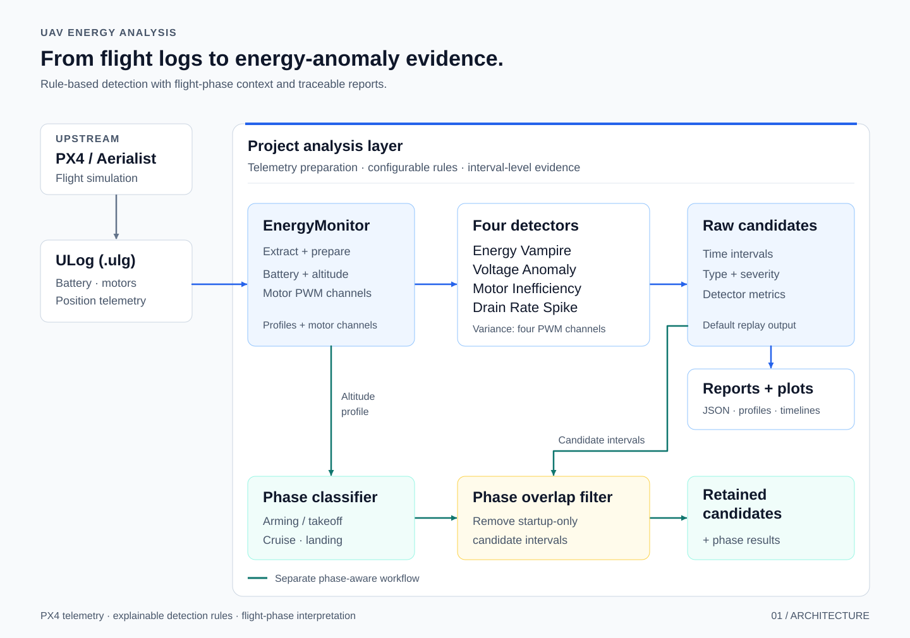
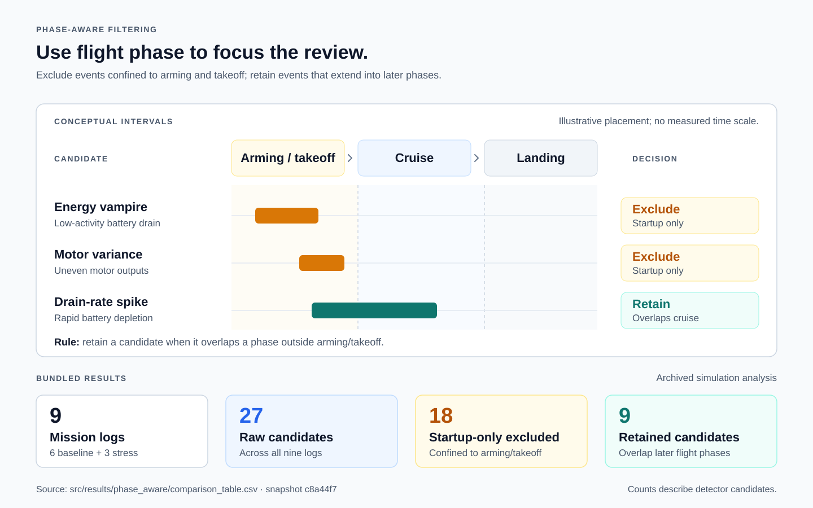

# Energy-Aware Testing for UAV Software

**Python · PX4 ULog · Time-series analysis · Simulation testing**

A Python framework that turns UAV flight logs into energy-anomaly candidates, visual evidence, and flight-phase context.

The project adds an analysis layer to PX4/Aerialist simulations: it extracts telemetry, applies four configurable detectors, and identifies which candidate intervals extend beyond startup. It includes six baseline mission logs, three custom stress missions, and archived reports for exploring the results.

[Architecture](#system-architecture) · [Results](#results-from-bundled-simulations) · [Run locally](#run-locally) · [Code guide](#code-guide)

## System architecture



The implementation separates **telemetry extraction**, **detection**, and **visualization**. Each candidate carries a time interval, severity, and supporting metrics, making it possible to inspect the signal behind a detection.

The replay runner produces raw reports and plots. A separate phase-aware analysis combines detector intervals with altitude-based flight phases.

## What the detectors look for

| Detector | Signal being examined |
|---|---|
| **Energy Vampire** | High battery drain during low mean motor activity |
| **Voltage Anomaly** | A large voltage range within a rolling window |
| **Motor Inefficiency** | High variance across four motor PWM outputs |
| **Drain Rate Spike** | Battery drain above a flight-relative baseline |

Detector thresholds are configurable in [`EnergyAnalyzer`](src/energy/analyzer.py). Battery drain is derived from changes in remaining battery percentage.

### Interpreting candidates by flight phase

The phase-aware filter excludes intervals contained entirely in arming/takeoff and retains intervals that overlap a later flight phase.



## Results from bundled simulations

Across **nine simulation logs**, the archived phase analysis records **27 raw candidates**, classifies **18 as startup-only**, and retains **9 drain-rate-spike candidates** extending into early cruise. The [comparison table](src/results/phase_aware/comparison_table.csv) and [detailed interval report](src/results/phase_aware/phase_aware_analysis_report.json) provide the underlying records.

| Experiment set | Included material |
|---|---|
| **Six baseline logs** | [UAV Testing Competition case studies](src/UAV-Testing-Competition/snippets/case_studies/) |
| **Three custom stress missions** | [Hover, zigzag, and altitude mission definitions](src/experiments/stress_missions/) with [flight logs and reports](data/stress_results/) |
| **Detector evaluation** | [Threshold-sweep implementation](src/run_threshold_sensitivity.py) and [synthetic telemetry-injection results](src/results/bug_injection/) |

The original mission profile below shows how candidate intervals relate to altitude, remaining battery, voltage, and motor output.


*Archived simulation telemetry for `mission1`, with raw detector intervals highlighted. [Source report](src/results/energy/mission1_report.json).*

## Run locally

Replay a bundled flight log with **Python 3.10**, the version recorded in the original project documentation. The [requirements file](src/requirements.txt) specifies minimum versions of pandas, NumPy, pyulog, and Matplotlib.

```bash
git clone https://github.com/Philjae-Shin/COMS30045_Individual_Project_Submisssion.git
cd COMS30045_Individual_Project_Submisssion
python3.10 -m venv .venv
source .venv/bin/activate
python -m pip install -r src/requirements.txt
```

From the repository root:

```bash
python src/aerialist_energy_runner.py \
  --analyze data/stress_results/stress_hover.ulg \
  --output results/replay
```

The runner writes a structured report and energy profile, plus a timeline when candidates are detected:

```text
results/replay/
├── stress_hover_report.json
├── stress_hover_energy_profile.png
└── stress_hover_bug_timeline.png
```

For new simulated flights, follow the included [Aerialist setup guide](src/Aerialist/README.md) and [custom stress-mission runner](src/experiments/run_stress_missions.sh).

## Code guide

| File | Responsibility |
|---|---|
| [`energy/monitor.py`](src/energy/monitor.py) | Extract battery, motor, and position telemetry; build resampled profiles |
| [`energy/analyzer.py`](src/energy/analyzer.py) | Apply configurable detection rules and produce candidate intervals |
| [`energy/visualizer.py`](src/energy/visualizer.py) | Generate energy profiles, interval timelines, and flight comparisons |
| [`aerialist_energy_runner.py`](src/aerialist_energy_runner.py) | Replay a log and export reports to a selected output directory |
| [`phase_aware_analysis.py`](src/phase_aware_analysis.py) | Classify flight phases and filter candidate intervals |
| [`bug_injection_experiment.py`](src/bug_injection_experiment.py) | Evaluate detectors using modified telemetry and a clean control |

## Author and foundations

Developed by **Philjae (Henry) Shin** for the University of Bristol COMS30045 dissertation, supervised by **Dr Kerstin Eder**.

The energy-analysis modules, phase filtering, evaluation scripts, and custom stress missions are the project's contribution. The simulation and log sources build on [PX4](https://github.com/PX4/PX4-Autopilot), [Aerialist](src/Aerialist/README.md), and the [UAV Testing Competition](src/UAV-Testing-Competition/README.md), with [pyulog](https://github.com/PX4/pyulog) for parsing. The bundled [Aerialist](src/Aerialist/LICENSE.md) and [competition](src/UAV-Testing-Competition/LICENSE.md) components retain their original licenses.

